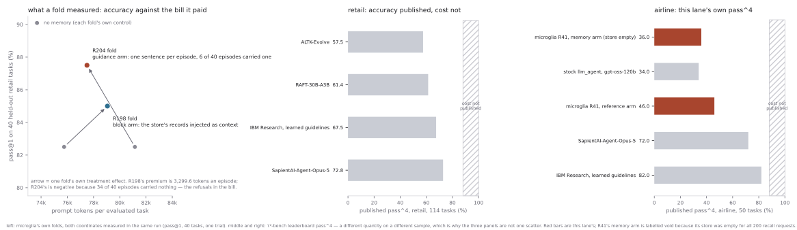
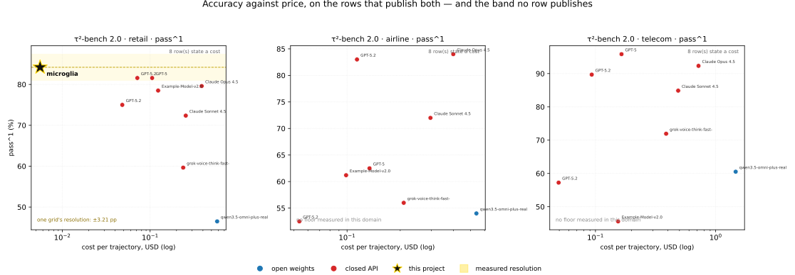

# Benchmarks, leaderboards, and the column none of them publishes

The project's claim is about a **data flywheel**: extract an experience from one episode, and use it to raise the
success rate of the next. That claim can only be settled on a benchmark where the same agent runs the same tasks
twice — once with the experience and once without. This page states which benchmarks can do that, what each
leaderboard publishes, and where this implementation sits.

Regenerate with `python3 scripts/accuracy-cost.py`. Every number in it is either a fold committed to this repository
or a leaderboard row with a date; nothing is estimated.

## What the three panels are

| panel | quantity | sample | why it is separate |
| --- | --- | --- | --- |
| left | pass@1 against prompt tokens **per task**, both coordinates from one run | 40 held-out retail tasks, one trial, 74 learned | the only place this project has both coordinates |
| middle | published pass^4, τ²-bench **retail** | 114 tasks, four trials | the field publishes the accuracy and no bill |
| right | published pass^4, τ²-bench **airline**, including this lane's own R41 | 50 tasks, four trials | the one column where microglia has a pass^4 on the leaderboard's own scale |

Three panels rather than one scatter, because pass^4 over four trials on 114 tasks and pass@1 over one trial on 40
are different quantities. A single axis carrying both would be the category error this project spends its rounds
refusing.

**The left panel's arrows are the treatment effects and they are the whole story of the last two rounds.** R198's
block arm bought +2.5 pp for 3,299.6 extra tokens an episode. R204's guidance arm came back with a *negative*
premium — the arm spent less than its control — because 34 of its 40 episodes carried nothing at all: a refusal
costs a summariser call and saves a block. That is not an efficiency, and the readback grades it as a failed
prediction rather than a saving.

## The benchmarks this claim can be tested on

| benchmark | leaderboard | LLM in the loop | reference stack | what it scores | cost published | this project |
| --- | --- | --- | --- | --- | --- | --- |
| **τ²-bench** (retail, airline) | its own board; submissions carry trajectories | **yes** — agent loop with a user simulator | **Python** (upstream), **TypeScript** in this repo's driver | pass^k on task completion | **2.0 only, on a minority of rows**: 8 of 48 retail, 9 of 47 airline, 9 of 43 telecom | measured: pass@1 82.5 / 85.0 / 87.5 on 40 retail tasks; retail pass^1 **84.20** on the 114-task domain at **$0.00558** a trajectory; airline pass^4 36.0 (void) and 46.0 on 50 tasks |
| **BIRD** (dev / Mini-Dev) | its own board, EX by submission | **yes** — generator, optional selector ensemble | **Python** | execution accuracy | **no** | measured: 57.63 dev (n = 1,534) no memory, 56.26 memory arm |
| **ALFWorld** | its own board | **yes** — embodied agent | **Python** | task success | **no** | measured, with 8 failure trajectories unexplained |
| **LongMemEval** | paper tables, no public board | **yes** | **Python** | answer accuracy over long sessions | **no** | not run here |
| **LoCoMo** | paper tables (Mem0 et al.) | **yes** | **Python** | QA over very long conversations | tokens per call, unusually | not run here |
| **MemoryAgentBench** | paper tables | **yes** | **Python** | multi-turn memory operations | **no** | not run here |
| **MEME** | paper tables | **yes** | **Python** | memory-editing accuracy | **no** | not run here |
| **MemTrapBench** | paper tables | **yes** | **Python** | whether a memory *misleads* | **no** | not run here; its AdaptiveMem direction is registered as a candidate arm |

**Answer to "is the field's instrumentation complete?" — no, and the gap is four columns, of which one has just
narrowed.** Every leaderboard above publishes an accuracy. One of them — τ² 2.0 — now also publishes a **cost per
trajectory on a minority of rows**, which is new since the earlier charts on this page were drawn and is the reason the
frontier chart below exists. None of them publishes the pack's size, whether the treatment was applied, the served
share of the treatment, or the sample's own resolution.

Regenerate with `python3 scripts/frontier.py`; the data is the pinned 2.0 snapshot in `eval/manifests/`.

| domain | rows on the directory | rows that state a cost | spread of `pass^1` | this project |
|---|---|---|---|---|
| retail | 48 | **8** | 46.5 → 81.6 across the priced rows; **86.20** at the top of the whole column (a 0.1.3 row), **84.43** the top text row at 1.0.1 | **84.20 at $0.00558** |
| airline | 47 | **9** | 52.5 → 84.0 | not measured |
| telecom | 43 | **9** | 57.2 → 92.3 | not measured |

**On the plane the priced rows define, nothing on the directory dominates this project.** The cheapest published retail
row is **8.6×** this project's price and 2.62 points below it; the most accurate priced row (GPT-5.2 at 81.58) is
**12.8×** the price. A factor of eight on a measured axis does not need a bigger sample to establish, which is why this
is the one comparative claim available today that does not run into the resolution floor that governs the accuracy
column.

**And the floor is the reason the accuracy column reads the way it does.** Retail holds 114 independent tasks, and the
paired difference between two arms has a floor of **3.21 points** there — no attempt count crosses it, because
repeating a task only lowers the measurement half of the error. Six text rows of the retail column sit inside that
band, so their ordering is a ranking of point estimates rather than of measured differences, in both directions. The
band is drawn on the retail panel and nowhere else: no floor has been measured for airline or telecom, and drawing an
unmeasured one would be the error the band exists to prevent.

## Where this implementation sits

| axis | microglia | the field's best published | gap |
| --- | --- | --- | --- |
| τ² retail, pass@1, 40 tasks | **82.5% control, 87.5% with a transient sentence** | no comparable row (the field reports pass^4) | not comparable |
| τ² retail, pass^4, 114 tasks | not measured at k = 4 | **72.8** (SapientAI), **67.5** (IBM, with disclosed train/base overlap) | unmeasured |
| τ² airline, pass^4, 50 tasks | **46.0** reference, 36.0 memory (void: empty store) | **82.0** (IBM), 72.0 (SapientAI) | −36 pp on the reference arm, before any treatment |
| memory's marginal effect, measured on the same episodes | **−3.44 pp pooled** over six folds, 78.7% of served packs inert | the literature's largest published effect is *how* the pack is made (49.0 → 59.9) | this lane is at the "no effect" end on retrieved records |

The honest summary: **this project is not SOTA on any leaderboard, and it is the only entrant that publishes the
numbers that would show whether anyone else is.** The 82.5% control against a 72.8 top is a statement about the
agent and the sample, not about memory — a pass@1 over 40 tasks is easier than a pass^4 over 114, and the two rows
must not be placed on one axis.

## What the field does not publish, and this repository does

| quantity | microglia | the field |
| --- | --- | --- |
| whether the treatment was applied | `V1-pack-not-empty`, blocking, and `serveYield.withheld` since R205 | not reported |
| paired per-episode ledger | `V33`, every request, holes included | not reported |
| net marginal effect with its own repair/break counts | `V17`, `serveYield`, `conditional` | a delta without the counts behind it |
| the sample's own resolution, beside the delta | `V5`, and the interval in every readback | rarely reported |
| the population a share was taken over | `withheld` + `injectedEpisodes` (R205) | not reported |

## What would move this project onto the board

1. **A pass^4 on 114 retail tasks** with the same folds — the only way to compare against the middle panel. Cost
   scales with 4 trials, so it is a priced decision rather than a free one.
2. **The material axis**, which is where the literature's largest effect lives: summarise the failing trajectory of
   the task at hand and discard it, rather than retrieving records from other tasks. R204 measured why this matters
   here — 34 of 40 episodes had nothing to say about the request.
3. **The store's governance flags as a treatment**: same items, same text, one validity flag flipped. The published
   audit reports −40.54 points on LongMemEval from bookkeeping alone, and this store already carries the flag.
